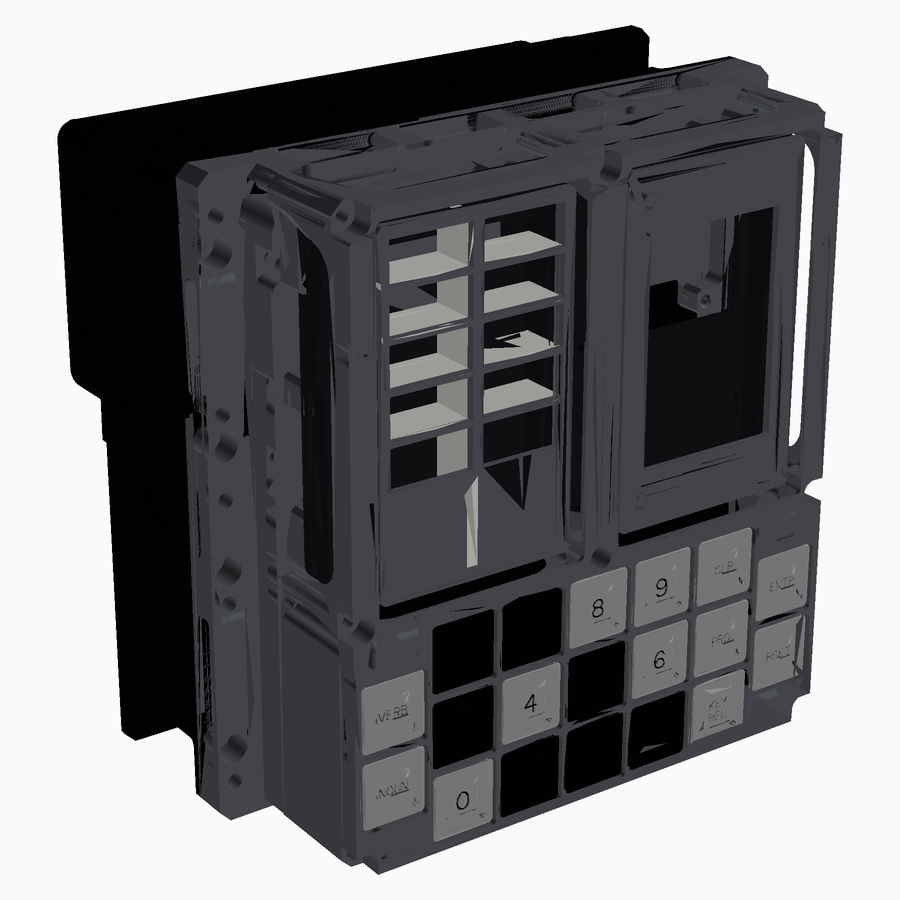

# DSKY Home Assistant terminal

An Apollo Guidance Computer DSKY lookalike that works as a Home Assistant control terminal. It has:

- a **Raspberry Pi Zero 2 W** with a 4.0" 800×480 touch screen in the display window: a **FYSETC CTP40** (a HyperPixel 4.0 clone; the model and BOM still show the HyperPixel, see *Pending steps*);
- 19 **Gateron low-profile** keys;
- 10 RGB **status lights**, driven by an **RP2040-Zero** that appears to the Pi as a USB device.



The mechanical design is based on [MKme/AGC_DSKY_Replica](https://github.com/MKme/AGC_DSKY_Replica) (GPL-3.0). The main case and rear cover are dropped, the mid frame is split for support-free printing, and the electronics are new.

## Repository layout

```
hardware/
  BOM.md                    full bill of materials (printed parts, fasteners, electronics)
  cad/
    DSKY_HA_Terminal.step   this build: both options in one file as selectable components
    DSKY_Original_Build.step  the original replica with lenses and its original electronics
  pcb/                      Option A: KiCad projects, panel, JLCPCB BOM/CPL (see pcb/README.md)
  diy/                      Option B: hand-wired schematic (KiCad) + wiring diagram
firmware/                   RP2040-Zero firmware (keys + status lights)  - to do
software/                   Pi side: Home Assistant UI / bridge          - to do
docs/img/                   renders
```

## Two ways to build it

| | Option A – Custom PCBs | Option B – Hand-wired |
|---|---|---|
| Keys | Hot-swap sockets on a factory-assembled PCB | Switches wired point-to-point with 1N4148 diodes |
| Status lights | WS2812B on a PCB behind the splitter | 10 WS2812B mini boards in a printed holder |
| You solder | 19 sockets, RP2040-Zero, 2 connectors | Everything |
| Firmware | same | same |

Both options use the same matrix and pins, so one firmware covers both builds:

- **Rows:** GP28, GP29, GP15.
- **Columns:** GP9–GP13, GP26, GP27.
- **LED data:** GP14.

In `DSKY_HA_Terminal.step` the top-level components *Option A – Custom PCBs* and *Option B – Hand-wired* hold the parts that differ between the builds. Hide one of them in Fusion 360 to see the other build.

## Status

**Work in progress, parked.** The hardware is designed and passes KiCad DRC. Nothing has been ordered or built yet, and the firmware and software haven't been started.

- [x] 3D model (both options), printable parts, fasteners
- [x] PCBs designed, routed and panelised; JLCPCB BOM/CPL
- [x] Hand-wired schematic
- [x] KiCad DRC and ERC on both boards, the panel and the DIY schematic: no errors (warnings only, listed below)
- [ ] Footprint check against real parts, then order
- [ ] 3D model updated for the CTP40 screen and the final keyboard PCB
- [ ] Firmware
- [ ] Home Assistant software

## Pending steps

Work through these in order; each group builds on the one before.

### 1. PCBs (before ordering)

1. **Print the keyboard board 1:1** and lay a real Gateron LP switch, hot-swap socket and RP2040-Zero on it.
2. **Gateron_LP_Hotswap footprint.** Its back-side courtyard (x −9.75…8.0, y 2.0…8.3) was estimated from the pad positions. Check it against the socket datasheet.
3. **RP2040-Zero footprint.** The copy on the keyboard board differs from the one in `lib/dsky.pretty`. Compare both with the Waveshare drawing, then keep the correct one in both places.
4. **3D viewer (Alt+3)** in KiCad: check that the sockets and RP2040 sit on the back and the LEDs on the front.
5. **Optional clean-ups** (all DRC warnings, none block ordering):
   - Net names differ between schematic and board (`/+5V` vs `+5V`, 235 parity warnings). It comes from the generator's labels; "Update PCB from schematic" would rename every net.
   - Add no-connect flags to the unused RP2040 pins and the last LED's DOUT (the ERC errors).
   - Silkscreen overlaps and clipping, the missing `MPN` field, `MouseBite_0.5` missing from the library.
6. **Order.** Follow `hardware/pcb/README.md`: Gerbers plus the BOM/CPL files from `pcb/jlcpcb/panel/`. Check the rotation of every part in JLCPCB's placement preview (WS2812B notch, diode bands).

### 2. Mechanical (3D model, in Fusion 360)

1. **Swap the HyperPixel for the CTP40** ([FYSETC/FYSETC-CTP40](https://github.com/FYSETC/FYSETC-CTP40)):
   - The CTP40's active area sits about 1.5 mm further along the long axis than the HyperPixel's, relative to the mounting holes. Move the two display-housing holes by that much (confirm against the FYSETC drawing first).
   - The CTP40's thickness isn't published. Measure it; the model allows 4.0 mm from the back of the board to the front of the glass.
   - Rename the "(HyperPixel)" parts here and in `hardware/BOM.md`.
2. **Keyboard PCB model:** update it to the KiCad board. It still has the old MX-style holes and lacks the RP2040 tab.
3. **Spacers:** the keyboard spacers are Ø6.5 mm. The PCB courtyards now allow for that (r 3.5 on the back), so keep them that size or smaller.
4. **`DSKY_Original_Build.step`** is referenced in the layout above but isn't in the repo. Add it or drop the reference.
5. Export the STLs (see `hardware/BOM.md`).

### 3. Firmware (RP2040-Zero)

Decisions to make first, one at a time:

1. **Stack:** CircuitPython, MicroPython, Arduino-Pico or KMK/QMK.
2. **Pi ↔ RP2040 protocol:** USB CDC serial, HID + serial, or something else. Key events go up to the Pi; lamp states come down.
3. **LED brightness limit:** all 10 LEDs at full white draw about 600 mA from the Pi's USB port, so the firmware must cap it.

Pins, matrix and LED order are in `firmware/README.md`.

### 4. Software (Pi Zero 2 W)

1. **CTP40 driver:** FYSETC ships Pi 3/Pi 4 overlays. Check what works on the current Raspberry Pi OS on the Zero 2 W.
2. **UI:** a kiosk browser (for example a Home Assistant dashboard) or a native app.
3. **VERB/NOUN mapping:** design how DSKY-style VERB/NOUN entries map to Home Assistant services.

### Notes for picking this up again

- **KiCad version.** The projects are KiCad 8 format. KiCad 10 opens them, but saving converts the files to the new format. Decide whether to upgrade before you edit and save in KiCad 10.
- **Generators.** `hardware/pcb/scripts/` generates the boards. Regenerating overwrites every hand edit, so prefer small targeted patches.
- **Python.** Python isn't on the PATH on the dev machine. KiCad's bundled Python works (it includes numpy): `"C:\Program Files\KiCad\10.0\bin\python.exe"`.
- **DRC from the command line.** This runs without saving the board:

  ```bash
  kicad-cli pcb drc --refill-zones --schematic-parity --severity-all -o drc.rpt hardware/pcb/keyboard-board/keyboard_board.kicad_pcb
  ```

  Use the same command for the status board, and drop `--schematic-parity` for the panel.

## Licence

GPL-3.0, inherited from the original AGC_DSKY_Replica project. See `LICENSE`.
