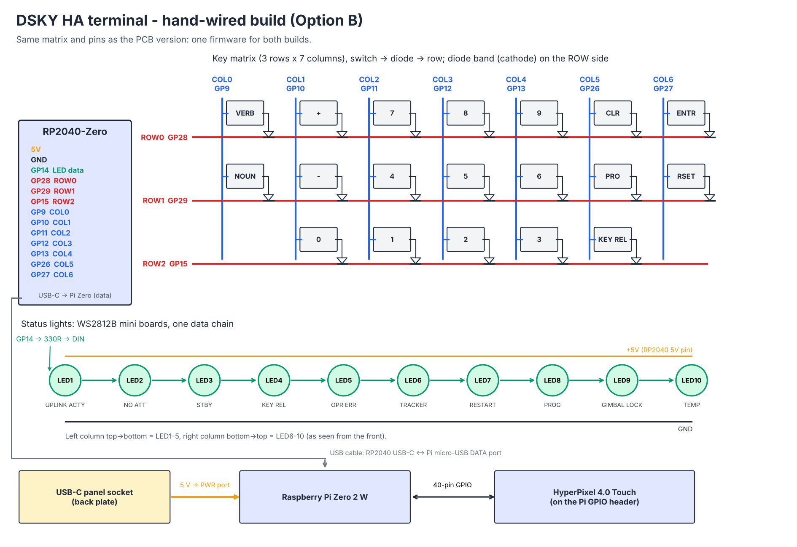

# Hand-wired build (Option B)

- `diy_wiring.kicad_sch` is the KiCad schematic. Open `diy_wiring.kicad_pro`; it uses the symbols in `../pcb/lib`.
- `diy_wiring.png` and `diy_wiring.svg` are the same wiring as a one-page diagram.

## Wiring

1. **Keys.** Wire a 3 × 7 matrix with the column wire to switch pin 1. Then connect switch pin 2 → 1N4148 → row wire, with the diode band (cathode) on the row side.
   - **Rows:** ROW0 = GP28, ROW1 = GP29, ROW2 = GP15.
   - **Columns:** COL0…COL6 = GP9, GP10, GP11, GP12, GP13, GP26, GP27.
2. **Status lights.** GP14 → 330 Ω → LED1 DIN, then DOUT → DIN through to LED10.
   - Order: the left column top to bottom (LED1–5), then the right column bottom to top (LED6–10), as seen from the front.
   - Every board gets +5V and GND from the RP2040-Zero 5V and GND pins.
3. **USB.** A short cable runs from the RP2040-Zero USB-C to the Pi Zero micro-USB **data** port. It powers the RP2040 and the LEDs and carries the key and LED traffic.
4. **Power in.** The USB-C panel socket on the back plate goes to the Pi Zero **PWR** port.

Keep the LED brightness modest in firmware: all 10 at full white draw about 600 mA from the Pi's USB port.

WS2812B LEDs usually accept 3.3 V data at 5 V supply over short wires. If the first LED flickers, add a 74AHCT1G125 or 74AHCT125 buffer, as on the PCB version, or power the LEDs from about 4.5 V.
